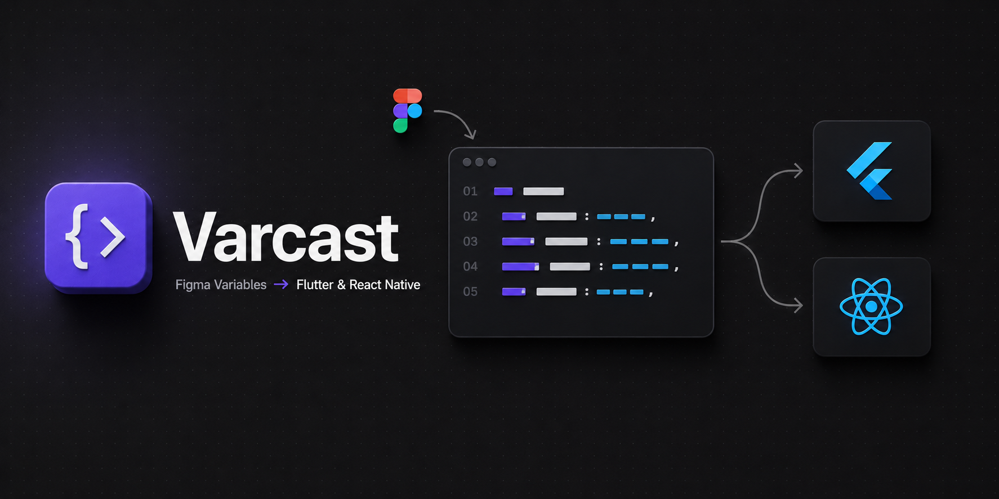

<p align="center">
  
</p>

# Varcast

Export Figma Variables and Styles to **Flutter** and **React Native** as fully-typed, mode-aware design system packages. Re-export anytime — stable identifiers survive Figma renames.

## Highlights

- Two targets, one Figma file — Flutter (Dart) and React Native (TypeScript).
- Aliases preserved as references; semantic tokens stay semantic in code.
- Per-target stable manifest — Figma renames never break consumer code.
- Mode-aware runtime: animated `DesignSystemController` (Flutter), `ThemeProvider` + `useTheme()` (RN).
- Paint / Effect / Text styles compile into typed composite containers.
- Validates before emit: cycle detection, unresolved aliases, float-noise rounding.
- Auto-generated `CHANGELOG.md` per export.

## Usage

1. Open Varcast in any Figma file with Variables and/or local Styles.
2. Pick **Target** + **Package name**. Toggle which buckets to include.
3. Click **Export** — the generated package downloads as a ZIP.

## Privacy

100% client-side. No network calls. The only persistence is `figma.clientStorage` for the per-file stable-identifier manifest, scoped to the current Figma user on the current device.

## Development

```bash
pnpm install
pnpm build          # production bundle → dist/
pnpm test           # vitest unit & integration tests
pnpm typecheck      # typescript validation
```

Load in Figma Desktop: `Plugins → Development → Import plugin from manifest…` → pick `manifest.json`.

## Testing & Quality Assurance

Varcast uses `sample/design_system_v5` as its **Golden Reference** (Ground Truth) for testing.

- **Unit tests**: `pnpm test` (or `pnpm test flutter`)
- **Integration tests**: `pnpm vitest run src/__tests__/ir_integration.test.ts`
- **E2E validation**: `bash scripts/e2e.sh` (runs full build, CLI package generation, `flutter analyze`, and `flutter test`).

For complete testing architecture and guidelines, see [docs/testing.md](../docs/testing.md).

## License

MIT — see [LICENSE](LICENSE).
